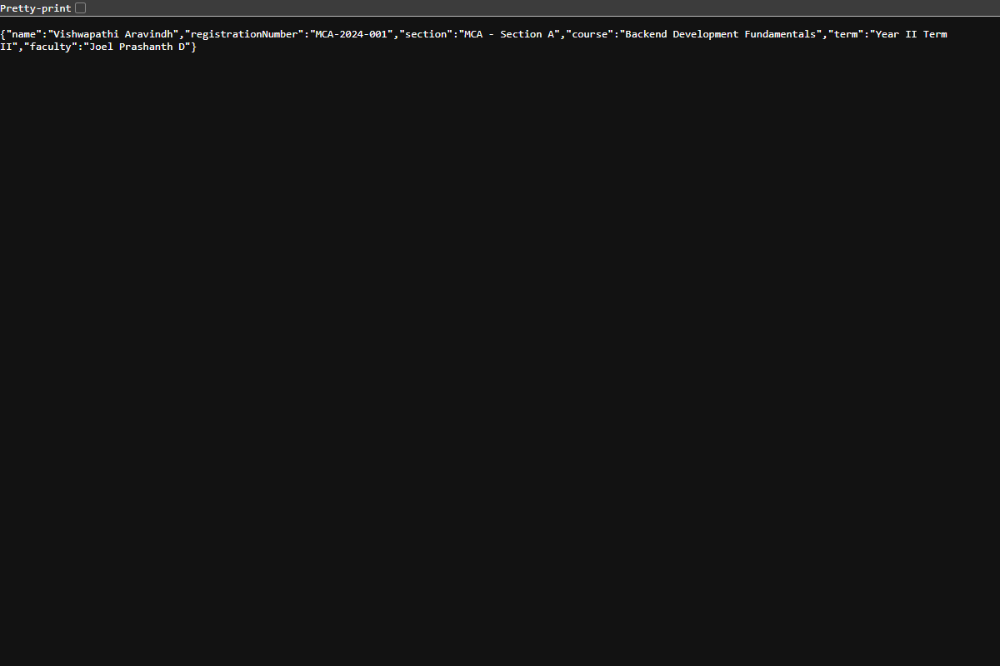
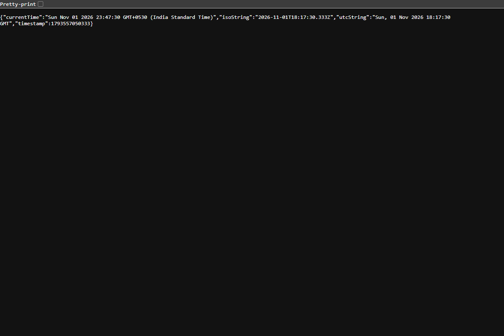
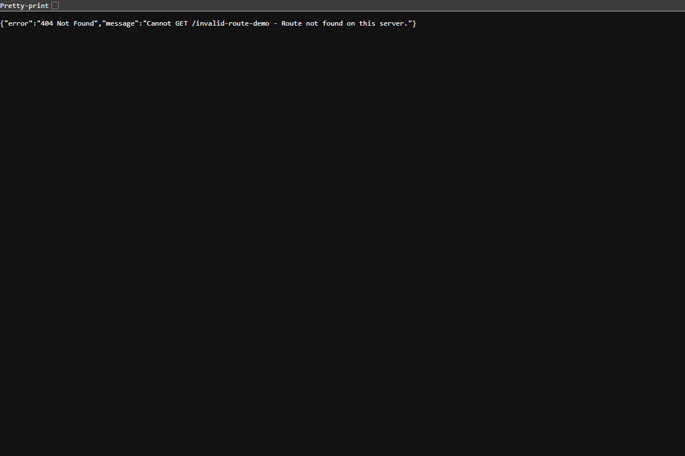

# Lab 1: Node.js and Express server

**GitHub Repository:** [https://github.com/cris-pat-37/backend-lab](https://github.com/cris-pat-37/backend-lab)  
**Name:** Vishwapathi Aravindh  
**Registration Number:** MCA-2024-001  
**Section:** MCA - Section A  
**Course:** Backend Development Fundamentals (Year II Term II · Aurora)  
**Faculty:**Mr Yugandhar Gurjalwar

---

## Live Link
- **Live Deployment URL:** `Not applicable (Local development server tested on http://localhost:3000; can be deployed directly to Render/Railway using npm start with PORT environment variable)`
- **Local Testing URL:** `http://localhost:3000`

---

## How to Run

### Prerequisites
- [Node.js](https://nodejs.org/) (v18.0.0 or higher recommended; verified on v24.12.0)
- [npm](https://www.npmjs.com/) (v9.0.0 or higher; verified on v11.6.2)
- Web browser (Google Chrome, Microsoft Edge, Firefox, or Postman / curl)

### 1. Installation
Navigate into the `lab-01` directory and install the required dependencies:
```bash
cd lab-01
npm install
```

### 2. Environment Variables
Create an optional `.env` file in `lab-01/` for local configuration (note: `.env` is ignored by Git and never committed):
```env
PORT=3000
NODE_ENV=development
```

### 3. Start Commands
- **Run the Express server (Tasks 4–6):**
  ```bash
  npm start
  ```
  *(Alternatively, with automatic reload: `npm run dev`)*

- **Run the Plain HTTP server (Task 3):**
  ```bash
  npm run start:http
  ```

---

## Tasks Overview & Explanations

### Task 1: `package.json` Field Explanation
Running `npm init -y` generates a default manifest file. Here is what each field represents:

| Field | Meaning / Purpose |
| :--- | :--- |
| `"name"` | The unique identifier / package name of the project. Must be lowercase and URL-friendly. |
| `"version"` | The current semantic version (`major.minor.patch`, e.g., `1.0.0`) of the application. |
| `"description"` | A human-readable description of what the project does. |
| `"main"` | The primary entry point file of the application (e.g., `server.js`). |
| `"scripts"` | Custom terminal alias commands executed via `npm run <script-name>` (e.g., `"start": "node server.js"`). |
| `"keywords"` | An array of search tags helping discover the package on npm registry. |
| `"author"` | The creator or maintainer's name and contact information. |
| `"license"` | The software license governing terms of use and distribution (e.g., `ISC`, `MIT`). |
| `"dependencies"` | Object listing production npm packages and their version constraints required to run the project. |

### Task 2: Locating Express in `node_modules`
Running `npm install express` downloads Express and its transitive dependencies into the local `node_modules` folder:
- **Location:** `lab-01/node_modules/express/`
- **Internal files:** Contains `package.json`, `index.js`, `Readme.md`, `LICENSE`, and `lib/` (which includes router, request, response, and application modules).
- **Git handling:** The `node_modules/` folder is explicitly excluded via `.gitignore` to prevent committing heavy third-party code.

### Task 3: Plain HTTP Server (`http-server.js`)
Built using Node.js's native `http` module:
```javascript
const http = require('http');
const PORT = 3000;

const server = http.createServer((req, res) => {
  res.writeHead(200, { 'Content-Type': 'text/plain; charset=utf-8' });
  res.end('Hello');
});

server.listen(PORT, () => {
  console.log(`Plain HTTP Server running on http://localhost:${PORT}`);
});
```

### Task 4, 5, 6: Express Server (`server.js`)
Rewritten with Express, providing clean declarative routing, JSON responses, request status logging, and a 404 handler for unmatched routes.

---

## Endpoints / Scripts Table

### Endpoints Table
| Method | Path | Status Code | Response Type | Description |
| :--- | :--- | :---: | :--- | :--- |
| **GET** | `/` | `200 OK` | `text/plain` | Root route displaying a welcome greeting text message. |
| **GET** | `/about` | `200 OK` | `application/json` | Returns a JSON payload containing student name, section, registration number, course, and faculty. |
| **GET** | `/time` | `200 OK` | `application/json` | Returns the current server date and time using `new Date()` (human string, ISO 8601, and timestamp). |
| **ALL** | `/*` (any unknown path) | `404 Not Found` | `application/json` | Catch-all handler for undefined routes with an error message. |

### NPM Scripts Table
| Script | Command | Purpose |
| :--- | :--- | :--- |
| `npm start` | `node server.js` | Starts the production Express server on port 3000. |
| `npm run start:http` | `node http-server.js` | Starts the plain built-in Node.js HTTP server. |
| `npm run dev` | `node --watch server.js` | Starts the Express server with native Node.js file watching for auto-restart on changes. |

---

## Screenshots

### 1. Plain HTTP Server (`http.createServer` replying "Hello")


### 2. Route: `GET /` (Welcome Text) — Status `200 OK`


### 3. Route: `GET /about` (JSON with Name and Section) — Status `200 OK`


### 4. Route: `GET /time` (Current Date and Time via `new Date()`) — Status `200 OK`


### 5. Route: Unknown Path (`GET /invalid-route-demo`) — Status `404 Not Found`


---

## Notes: Problems Faced and How You Solved Them

1. **Port Conflicts (`EADDRINUSE`):**
   - *Problem:* Running both `http-server.js` and `server.js` concurrently caused an address collision on port 3000.
   - *Solution:* Implemented dynamic port selection via `const PORT = process.env.PORT || 3000` so either server can run on custom ports (e.g. `PORT=3001 npm run start:http`) or sequentially without overlap.

2. **JSON Content-Type Header:**
   - *Problem:* In plain Node.js `http`, returning JSON requires manually specifying headers (`res.writeHead(200, { 'Content-Type': 'application/json' })`) and stringifying with `JSON.stringify()`.
   - *Solution:* Leveraging Express's built-in `res.json()`, which automatically sets `Content-Type: application/json` and serializes JavaScript objects cleanly.

3. **Handling Unknown Routes Gracefully:**
   - *Problem:* Default Express 404 page returns raw HTML (`Cannot GET /path`), which is inconsistent with JSON APIs.
   - *Solution:* Added a fallback middleware at the very end of the routing pipeline (`app.use((req, res) => { ... })`) that explicitly emits an HTTP status of `404` with a structured JSON error body.

---

## Viva Questions & Answers

### 1. What is the difference between `package.json` and `node_modules`?
- **`package.json`:** A lightweight metadata manifest file committed to Git. It tracks project details, scripts, and lists the direct dependencies and acceptable version ranges (`^`, `~`) that the project relies on.
- **`node_modules`:** A physical directory where npm downloads and stores the actual compiled JavaScript code and binaries for all dependencies and sub-dependencies. It is very heavy, machine-specific, and should **never** be committed to Git (it is restored via `npm install`).

### 2. What does `app.listen()` do?
- In Express, `app.listen(port, [callback])` binds the Express application to an HTTP server and begins listening for incoming TCP connections on the specified port.
- Under the hood, it is identical to calling Node's `http.createServer(app).listen(port, callback)`.

### 3. What do `request` (`req`) and `response` (`res`) represent?
- **`request` (`req`):** An object representing the incoming HTTP request sent by the client. It contains details such as the HTTP method (`req.method`), URL/path (`req.originalUrl` or `req.path`), headers (`req.headers`), URL query parameters (`req.query`), route parameters (`req.params`), and body payload (`req.body`).
- **`response` (`res`):** An object used by the server to construct and dispatch the outgoing HTTP response back to the client. It provides methods to set the HTTP status code (`res.status()`), set headers (`res.set()`), and transmit data (`res.send()`, `res.json()`, `res.end()`).

